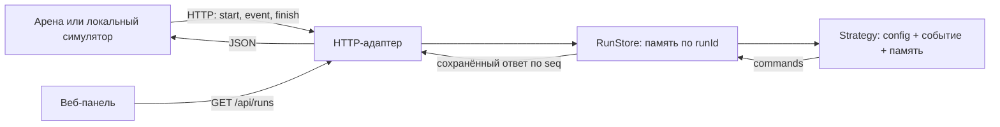

# Архитектура и развитие

## Поток данных

HTTP-слой не выбирает стратегию производства. Стратегия не вызывает сеть, не читает
рынок симулятора и получает ровно те данные, которые доступны из start и event.
Симулятор знает скрытые параметры только для оценки предложений. По завершении
скрытые buyers из finish отбрасываются хранилищем; память между runId не переносится.

## Замена алгоритма

Новый класс реализует `decide(config, payload, memory) -> list[dict]`.
В `RunStore(strategy=...)` передаётся его экземпляр. Всё изменяемое знание о рынке
должно находиться в `memory`, а не в полях общего экземпляра стратегии.
RunStore передаёт копию памяти и сохраняет её после успешного вызова.
Снимок state — источник истины для предметов и станков; локальные предположения
о выполнении команд нужно сверять с report и следующими снимками.

Конфигурация арены приходит в start. Базовый планировщик ориентирован на v1:
обрабатывает шаблоны входов и наследование обобщённо, но порядок стадий, выбор
свойств и оценка времени до конца смены пока привязаны к производственной цепочке v1.
Поддержка v2 должна быть отдельной явной доработкой.

## Надёжность и границы основы

- Один процесс Python, один RunStore в оперативной памяти. Несколько процессов
  без общего хранилища запускать нельзя: события одного прогона могут попасть в разные процессы.
- Блокировка на прогон защищает стратегию и кэш от одновременной обработки seq.
- Повторы start с той же конфигурацией не стирают знания; другая конфигурация того
  же runId отклоняется. Новое испытание должно иметь новый runId.
- Ответы сохраняются по seq; новое событие с меньшим seq отклоняется. Пропуски seq
  допускаются: арена не повторяет события после таймаута.
- Хранилище и журнал пока не имеют автоматической очистки, экспорта или восстановления.
  Для длительной эксплуатации нужны ограничение срока хранения и персистентность.
- Измеряется время решения, но принудительного прерывания медленной стратегии нет.
  Лимит eventTimeoutMs окончательно контролирует арена; при усложнении алгоритма
  нужен собственный бюджет вычислений и быстрый запасной ответ.
- Встроенный HTTP-сервер предназначен для разработки и первичной интеграции.
  Перед раундом нужны публичное размещение, перезапуск при сбое и официальный check.
- Формальный openapi.yaml не был предоставлен. Сервис сделан по текстовой спецификации;
  после получения схем нужно сверить все поля, ошибки и допустимые идентификаторы.

## Следующие задачи

1. Получить официальный openapi.yaml и выполнить check в песочнице арены.
2. Добавить модель покупателя: гипотезы о любимом типе, Pmax и f с учётом шума ±2%.
3. Выделить выбор предложения в отдельный модуль; сравнивать ценность продажи и информации.
4. Планировать желаемые типы роботов вместе с загрузкой станков и паузами покупателей.
5. Добавить целевые уровни запасов, утилизацию и расчёт оставшегося времени по цепочке.
6. Сделать пакетные сравнения стратегий на множестве миров и сохранение полных журналов.
7. Дополнить интерфейс объёмом выпуска, продажами, отказами и разложением расходов.
8. Подготовить публичный запуск и инструкцию защиты проекта.
